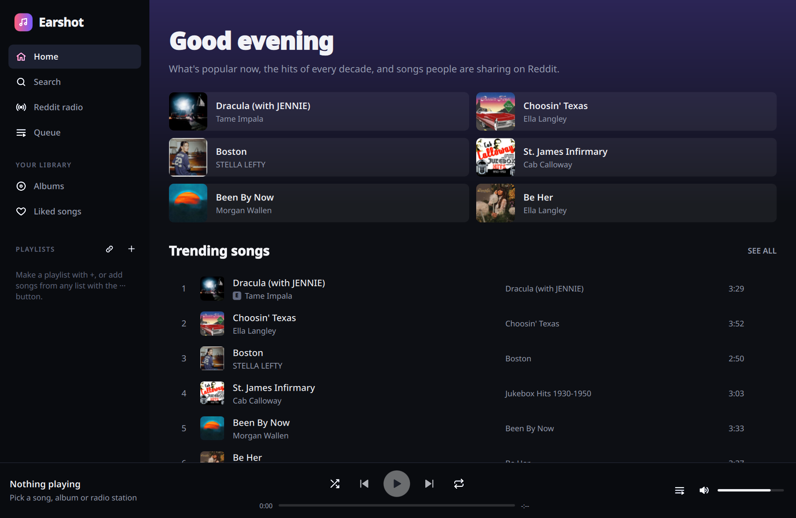
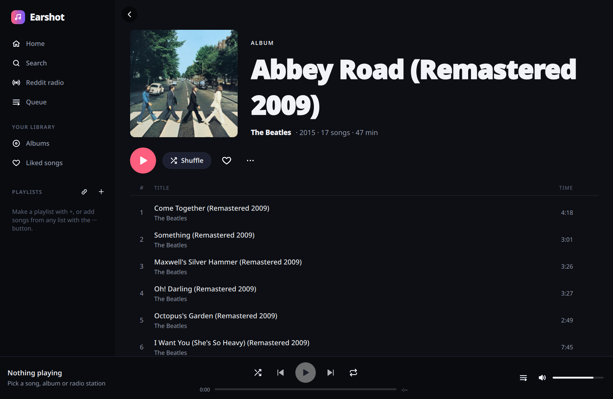
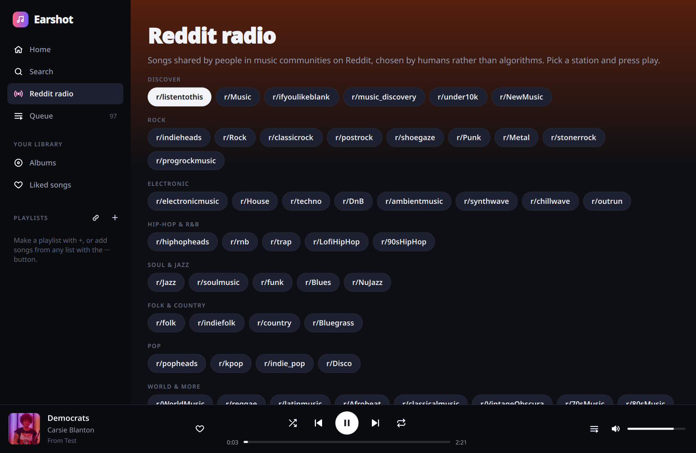

# Earshot

A modern desktop music player written in Rust and Qt Quick ([cxx-qt](https://github.com/KDAB/cxx-qt)).
It's a fresh take on the ideas of the (no longer maintained) [Headset](https://github.com/headsetapp/headset-electron)
Electron app: popular music by genre and era, a radio made of songs people share on Reddit, and YouTube as the
music source. Earshot adds real **albums**, **artist pages** and **playlists**.

Project page: https://benwbooth.github.io/earshot/ (served by GitHub Pages from `docs/`).



| Album | Reddit radio |
|---|---|
|  |  |

## Features

- **Home**: trending songs and albums, plus charts for 20+ genres and every decade from the 50s to the 2020s.
- **Search**: songs, albums and artists, with a top result; a **YouTube** tab finds live sets, covers and anything
  not in the catalogue.
- **Albums**: full track lists with artwork, release date, label and running time. Play, shuffle, add the whole
  album to the queue or a playlist, or save it to **Your albums**.
- **Artists**: popular songs and the complete discography (albums, singles and EPs).
- **Reddit radio**: about 50 music subreddits (r/listentothis, r/indieheads, r/jazz, r/synthwave…) in groups. Songs
  play in the order the community ranks them; save any station as a playlist.
- **Playlists**: create, rename, delete, reorder (Move up / Move down), filter, and add songs from any list with the
  `···` menu. **Liked songs** collects everything you heart. Import a YouTube or YouTube Music playlist by link.
- **Queue**: play next, add to queue, remove, clear upcoming; shuffle and repeat (all / one).
- Keyboard: Space play/pause, Ctrl+←/→ previous/next, Ctrl+F search, Ctrl+N new playlist, Ctrl+S shuffle,
  Ctrl+R repeat, Alt+← back, and the media keys while the window has focus.

## How it works

- Catalogue data and artwork come from Deezer's public API (no account or key needed).
- Search, playlists and the chapter timestamps of long videos come straight from YouTube's own web API, in
  youtube.com's order. Playlists and full-length videos (soundtracks, full albums) open as albums, with long videos
  split into tracks at their timestamps.
- Songs play in YouTube's own embedded player, hosted out of sight in Qt WebEngine (as the original Headset did).
  Nothing is downloaded and no external programs are needed. For catalogue songs Earshot picks the best-matching
  video (official audio of the right length) and looks up the next songs ahead of time, so they start at once.
- The waveform is measured from what your speakers play, with the [cpal](https://github.com/RustAudio/cpal) audio
  library: loopback recording on Windows and macOS 14.6+, the PipeWire speaker monitor on Linux.
- Your playlists, liked songs and saved albums live in `~/.local/share/earshot/library.json`.

## Install

Downloads are on the [releases page](https://github.com/benwbooth/earshot/releases/latest).

- **Windows**: `Earshot-…-windows-x64-setup.exe` installs Earshot; `…-windows-x64-portable.zip` runs from any
  folder without installing.
- **macOS** (Apple silicon, macOS 13+): open `Earshot-…-macos-arm64.dmg` and drag Earshot to Applications, or use
  Homebrew:
  ```sh
  brew tap benwbooth/earshot https://github.com/benwbooth/earshot
  brew install --cask earshot
  ```
  Earshot isn't notarized by Apple; if macOS won't open the dmg's copy, run
  `xattr -dr com.apple.quarantine /Applications/Earshot.app` once (Homebrew does this for you).
- **Linux**:
  - Flatpak, from Earshot's own Flatpak repository (updates with `flatpak update`):
    ```sh
    flatpak install --user https://benwbooth.github.io/earshot/flatpak/earshot.flatpakref
    ```
    or download the single-file bundle `Earshot-…-x86_64.flatpak` and `flatpak install --user` it.
  - AppImage: download `Earshot-…-x86_64.AppImage`, make it executable and run it.
  - Nix: `nix run github:benwbooth/earshot`.

New versions are built by GitHub Actions (`.github/workflows/release.yml`) whenever a `v*` tag is pushed.

## Build and run (Nix)

```sh
nix run github:benwbooth/earshot          # or, from a checkout:
nix build && ./result/bin/earshot
```

Development:

```sh
nix develop
cargo run
cargo test
```

Without Nix you need Rust and Qt 6.8+ (Base, Declarative, Svg, WebEngine), plus PipeWire and ALSA development files
on Linux; point `QMAKE` at Qt 6's `qmake` and run `cargo build --release`. On Wayland/KDE the now-playing card uses
`layer-shell-qt` when it's installed.

Environment variables: `EARSHOT_DATA_DIR` (where the library is kept), `EARSHOT_WINDOW_BUTTONS`
(`kde`, `gnome`, `windows` or `mac`, to force a window-button style).

## Notes

- Reddit sometimes rate-limits requests from apps; if a station won't load, wait a minute and press Refresh.
- Earshot is an independent project and is not affiliated with Headset, Deezer, YouTube or Reddit.

## License

MIT
