# Earshot

**A music player for all of YouTube's music, plus Bandcamp, SoundCloud, Mixcloud and the Internet Archive, in one
library.** Search them all at once, play full albums and soundtracks, keep your playlists in one place, and let
Earshot find more music like what you play. For Windows, macOS and Linux, with a web version for your phone. Free,
with no account to sign up for.

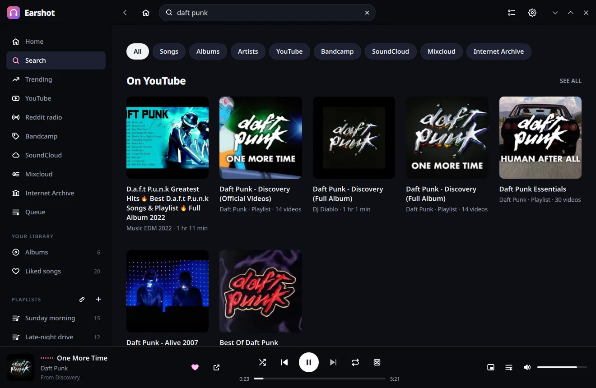

| | |
|---|---|
| 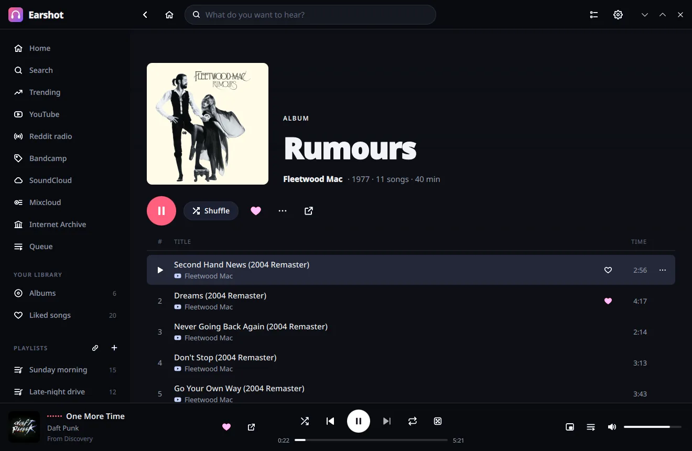 | 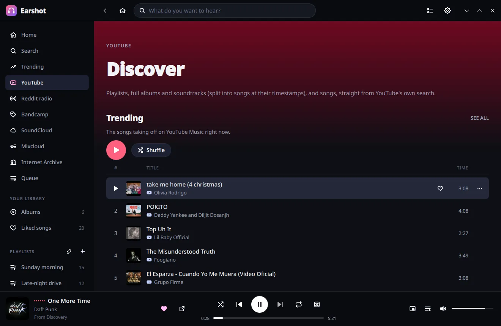 |
| 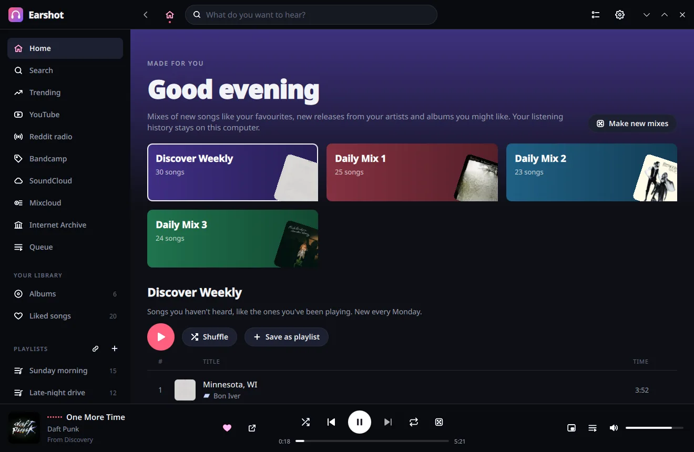 | 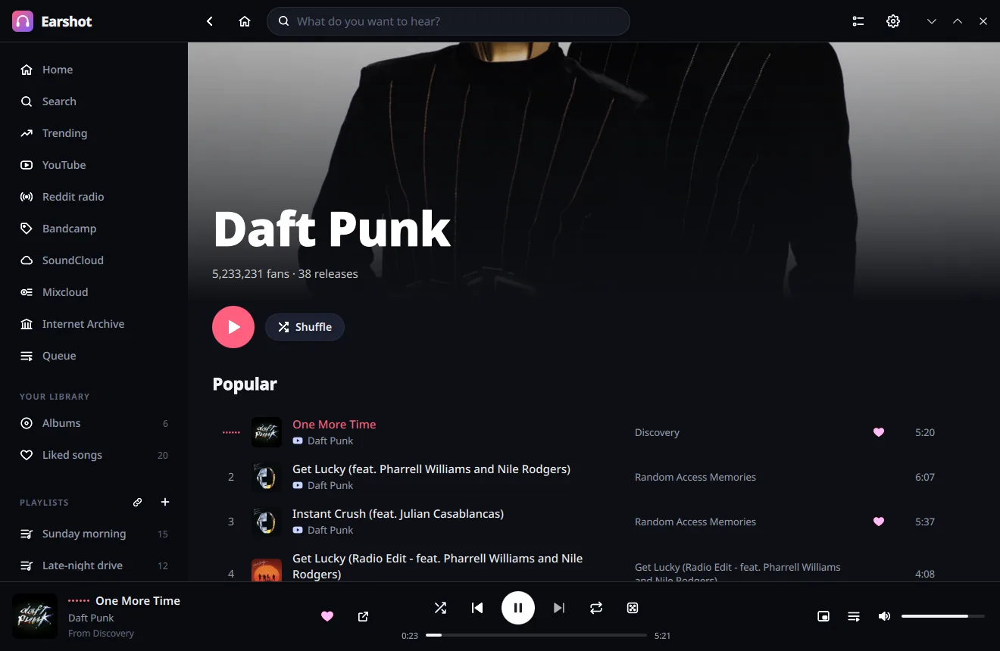 |
| 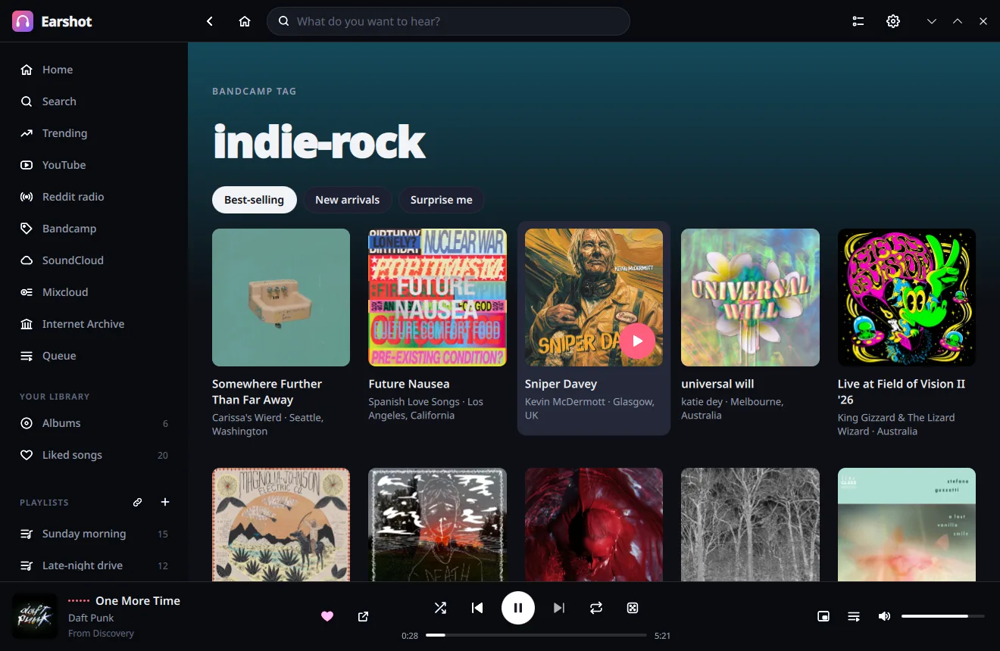 | 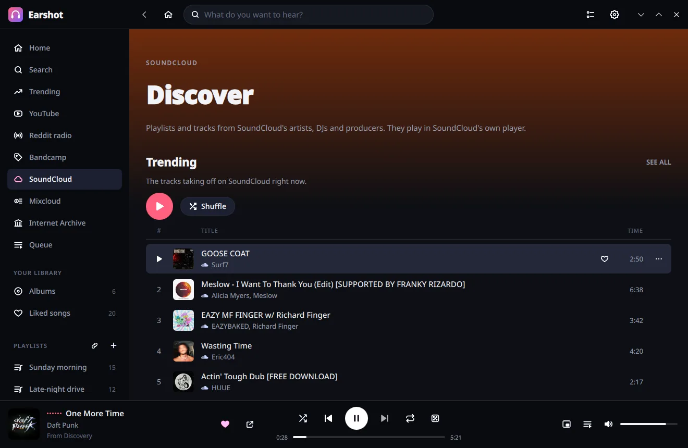 |
| 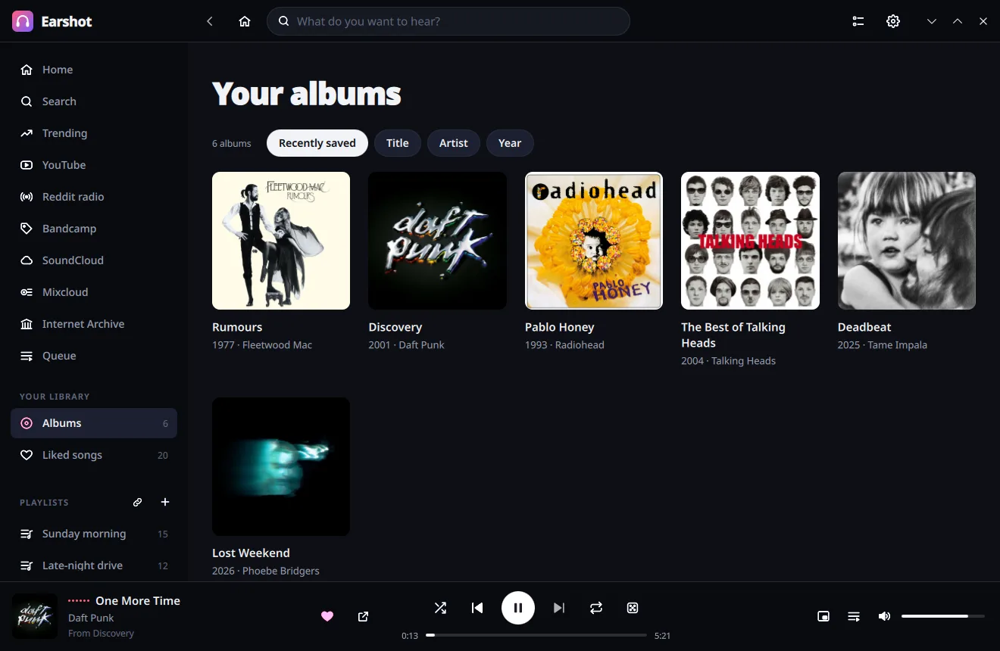 | 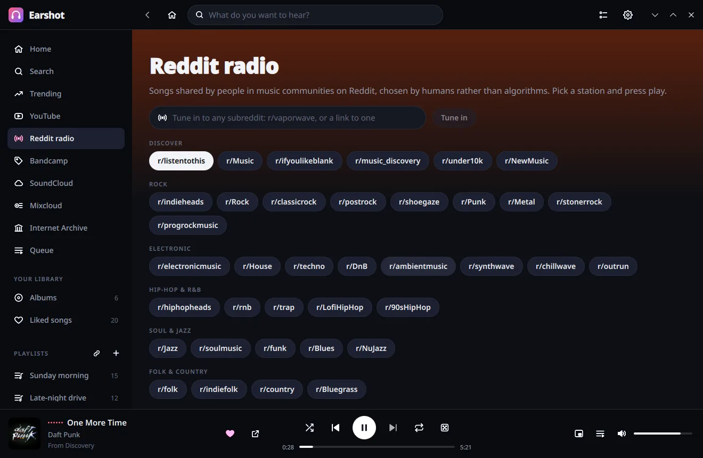 |

**Mini player** and the **now-playing card**:

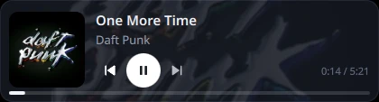 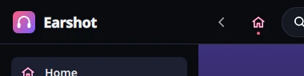

**The web version**, on a computer and on a phone:

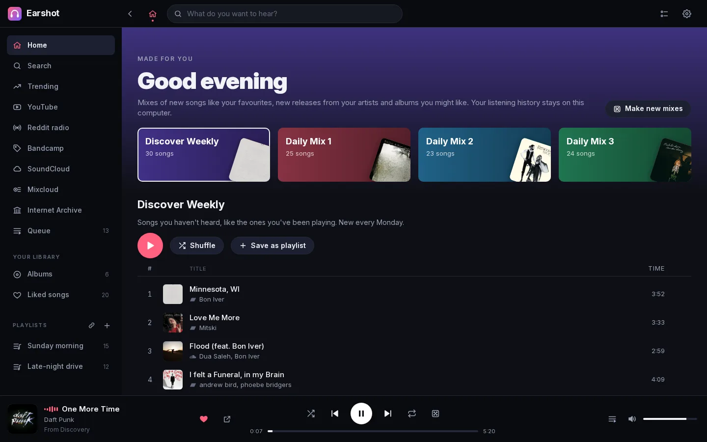

<p>
  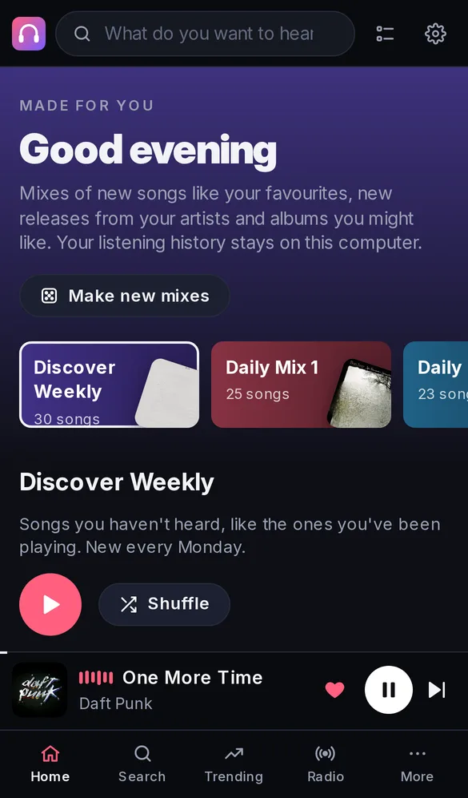
  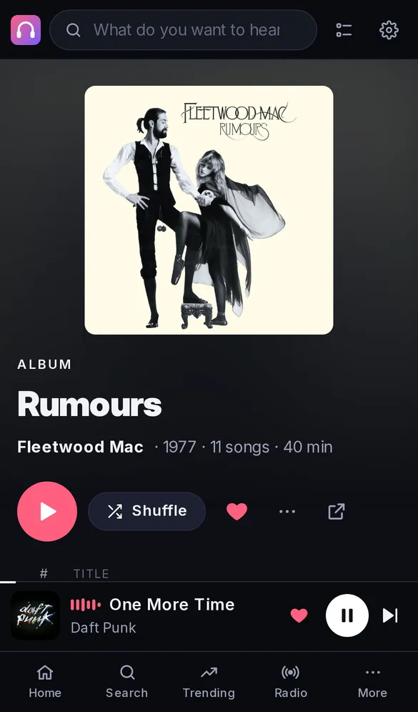
  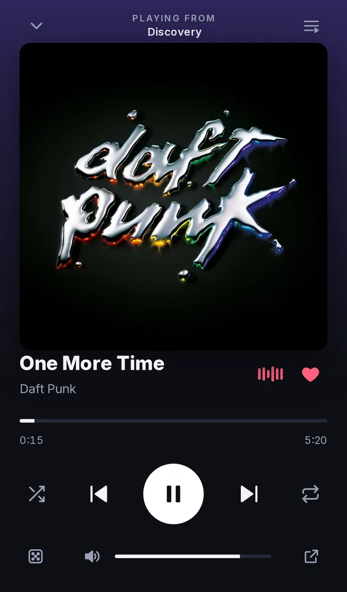
</p>

## What you can do

- **All of YouTube's music**: search songs, music videos, playlists and full albums, with music ahead of everything
  else in the results. Full-length album and soundtrack videos open as albums, split into their songs.
- **Everything else in the same place**: Bandcamp, SoundCloud, Mixcloud and the Internet Archive sit right next to
  YouTube. One search covers them all, and their songs go in the same playlists and queue.
- **Browse like a record shop**: YouTube's albums and soundtracks by genre or mood, Bandcamp by genre or any tag,
  SoundCloud's trending tracks, Mixcloud's DJ mixes, and the Internet Archive's live concerts and 78 rpm records.
- **Albums and artists, properly**: full track lists, artwork, release dates and complete discographies. Save the
  albums you love to **Your albums**.
- **Made for you**: Discover Weekly, Daily Mixes, Release Radar and Albums for you, built from what you play on
  any of the services. Your listening history never leaves your computer.
- **Never run out**: turn on random radio (the dice next to repeat) and Earshot keeps playing songs like the last
  ones when your queue ends.
- **Playlists your way**: create, reorder and filter playlists, heart songs into **Liked songs**, and import
  playlists from YouTube, SoundCloud or Mixcloud by pasting a link.
- **More ways to discover**: trending songs and albums, charts for 20+ genres and every decade from the 50s to
  today, and radio stations made of the songs shared in about 50 music communities on Reddit.
- **Stays out of the way**: a mini player, a small now-playing card when a song starts, a tray icon, media keys,
  and it reopens right where you left it.
- **On your phone too**: the web version runs in any browser and shares your playlists with the app.

## Where the music comes from

Earshot plays everything from the services themselves, in their own players. Nothing is downloaded.

- **YouTube**: most of the music. Songs, official videos, playlists, full albums, soundtracks and live sets, found
  with YouTube's own search and YouTube Music's.
- **Bandcamp**: independent artists and labels, by genre or tag, with Bandcamp's own picks of the day.
- **SoundCloud**: tracks, remixes and playlists from artists, DJs and producers.
- **Mixcloud**: DJ mixes and radio shows.
- **The Internet Archive**: live concerts from the Live Music Archive, 78 rpm records and netlabel releases.
- **Deezer's catalogue**: album and artist details and artwork (the songs themselves play from YouTube).
- **Reddit**: the songs people share in music communities, for Reddit radio.

## Download

Project page: **https://benwbooth.github.io/earshot/**

Get the latest version from the [releases page](https://github.com/benwbooth/earshot/releases/latest).

### Windows

Download **`Earshot-…-windows-x64-setup.exe`** and run it. Prefer not to install? The **`…-portable.zip`** runs
from any folder.

### macOS (Apple silicon, macOS 13 or later)

Open **`Earshot-…-macos-arm64.dmg`** and drag Earshot to Applications. Or use Homebrew:

```sh
brew tap benwbooth/earshot https://github.com/benwbooth/earshot
brew install --cask earshot
```

If macOS says Earshot can't be opened (it isn't notarized by Apple), run this once:
`xattr -dr com.apple.quarantine /Applications/Earshot.app`. Homebrew does this for you.

### Linux

- **Flatpak**: Earshot uses the KDE runtime from Flathub, so add Flathub first if you haven't:

  ```sh
  flatpak remote-add --user --if-not-exists flathub https://dl.flathub.org/repo/flathub.flatpakrepo
  ```

  Then either install the single file, or add Earshot's Flatpak repository so `flatpak update` keeps it current.

  *The single file*: download **`Earshot-…-x86_64.flatpak`** and run

  ```sh
  flatpak install --user Earshot-*-x86_64.flatpak
  ```

  *The repository*: download **`earshot-flatpak-repo.tar.gz`**, then

  ```sh
  mkdir -p ~/.local/share/earshot-flatpak
  tar -xzf earshot-flatpak-repo.tar.gz -C ~/.local/share/earshot-flatpak
  flatpak remote-add --user --no-gpg-verify --if-not-exists earshot "file://$HOME/.local/share/earshot-flatpak/flatpak-repo"
  flatpak install --user earshot io.github.benwbooth.Earshot
  ```

  For a new version, download its `earshot-flatpak-repo.tar.gz` and unpack it the same way (replacing the old one),
  then run `flatpak update --user`.

  Start Earshot from your app menu, or with `flatpak run io.github.benwbooth.Earshot`.
- **AppImage**: download **`Earshot-…-x86_64.AppImage`**, make it executable, and run it.
- **Nix**: `nix run github:benwbooth/earshot`.

## The web version

Use Earshot in a browser — on another computer or your phone — with the same playlists and liked songs as the app.

- **From the app**: open Settings (the gear, or Ctrl+,) and choose **Open the web version**.
- **On a home server, with Docker**:

  ```sh
  docker run -d -p 8790:8790 -v ~/earshot:/data ghcr.io/benwbooth/earshot:latest
  ```

  Then open `http://<your server>:8790/` on any device on your network. Your library is kept in `~/earshot`.

## Handy keys

Space play/pause · Ctrl+← / Ctrl+→ previous/next · Ctrl+F search · Ctrl+N new playlist · Ctrl+S shuffle ·
Ctrl+R repeat · Alt+← back · media keys

## Good to know

- Music plays from YouTube, Bandcamp, SoundCloud, Mixcloud and the Internet Archive, through their own players.
  Nothing is downloaded.
- Reddit lets apps without an account load about one station a minute. Earshot remembers each station, so it opens
  straight away and refreshes when Reddit allows.
- Earshot is inspired by the no-longer-maintained [Headset](https://github.com/headsetapp/headset-electron) app. It is
  an independent project, not affiliated with Headset, Deezer, YouTube, Bandcamp, SoundCloud, Mixcloud or Reddit.

Want to build Earshot yourself or help out? See [DEVELOPMENT.md](DEVELOPMENT.md).

## License

MIT
