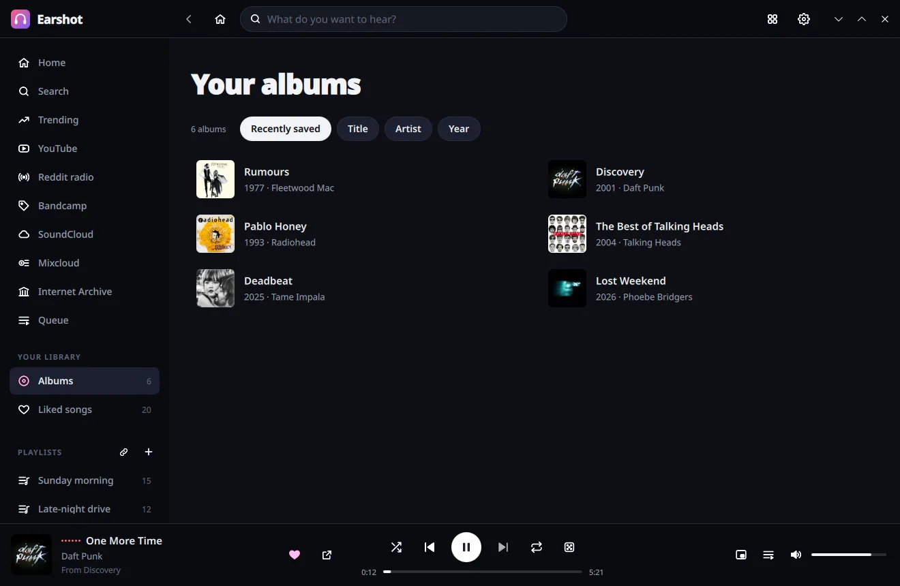

# Earshot

**A music player for your desktop that finds the music for you.** Charts for every genre and decade, radio stations
made of the songs people share on Reddit, real albums and artist pages, and mixes built from what you play — all
free, with no account to sign up for.


| | |
|---|---|
|  |  |
|  |  |
|  |  |
|  |  |

**Mini player** and the **now-playing card**:

 

**The web version**, on a computer and on a phone:


<p>
  
  
  
</p>

## What you can do

- **Discover what's popular**: trending songs and albums, plus charts for 20+ genres and every decade from the 50s
  to today.
- **Listen to Reddit radio**: about 50 music communities (r/listentothis, r/indieheads, r/jazz, r/synthwave…),
  played in the order their members rank them. Save any station as a playlist.
- **Search everywhere at once**: songs, albums and artists, plus YouTube, Bandcamp, SoundCloud, Mixcloud and the
  Internet Archive for live sets, covers, DJ mixes, concert recordings and independent releases.
- **Browse like a record shop**: Bandcamp by genre or any tag, YouTube's full albums and soundtracks by mood,
  Mixcloud's popular shows, and the Internet Archive's live concerts and 78 rpm records.
- **Albums and artists, properly**: full track lists, artwork, release dates and complete discographies. Save the
  albums you love to **Your albums**.
- **Made for you**: Discover Weekly, Daily Mixes, Release Radar and Albums for you, built from what you listen to.
  Your listening history never leaves your computer.
- **Never run out**: turn on random radio (the dice next to repeat) and Earshot keeps playing songs like the last
  ones when your queue ends.
- **Playlists your way**: create, reorder and filter playlists, heart songs into **Liked songs**, and import
  playlists from YouTube, SoundCloud or Mixcloud by pasting a link.
- **Stays out of the way**: a small now-playing card when a song starts, a tray icon, media keys, and it reopens
  right where you left it.
- **On your phone too**: the web version runs in any browser and shares your playlists with the app.

## Download

Project page: **https://benwbooth.github.io/earshot/**

Get the latest version from the [releases page](https://github.com/benwbooth/earshot/releases/latest).

### Windows

Download **`Earshot-…-windows-x64-setup.exe`** and run it. Prefer not to install? The **`…-portable.zip`** runs
from any folder.

### macOS (Apple silicon, macOS 13 or later)

Open **`Earshot-…-macos-arm64.dmg`** and drag Earshot to Applications. Or use Homebrew:

```sh
brew tap benwbooth/earshot https://github.com/benwbooth/earshot
brew install --cask earshot
```

If macOS says Earshot can't be opened (it isn't notarized by Apple), run this once:
`xattr -dr com.apple.quarantine /Applications/Earshot.app`. Homebrew does this for you.

### Linux

- **Flatpak**: download **`Earshot-…-x86_64.flatpak`** and run `flatpak install --user Earshot-*.flatpak`.
- **AppImage**: download **`Earshot-…-x86_64.AppImage`**, make it executable, and run it.
- **Nix**: `nix run github:benwbooth/earshot`.

## The web version

Use Earshot in a browser — on another computer or your phone — with the same playlists and liked songs as the app.

- **From the app**: open Settings (the gear, or Ctrl+,) and choose **Open the web version**.
- **On a home server, with Docker**:

  ```sh
  docker run -d -p 8790:8790 -v ~/earshot:/data ghcr.io/benwbooth/earshot:latest
  ```

  Then open `http://<your server>:8790/` on any device on your network. Your library is kept in `~/earshot`.

## Handy keys

Space play/pause · Ctrl+← / Ctrl+→ previous/next · Ctrl+F search · Ctrl+N new playlist · Ctrl+S shuffle ·
Ctrl+R repeat · Alt+← back · media keys

## Good to know

- Music plays from YouTube, Bandcamp, SoundCloud, Mixcloud and the Internet Archive, through their own players.
  Nothing is downloaded.
- Reddit lets apps without an account load about one station a minute. Earshot remembers each station, so it opens
  straight away and refreshes when Reddit allows.
- Earshot is inspired by the no-longer-maintained [Headset](https://github.com/headsetapp/headset-electron) app. It is
  an independent project, not affiliated with Headset, Deezer, YouTube, Bandcamp, SoundCloud, Mixcloud or Reddit.

Want to build Earshot yourself or help out? See [DEVELOPMENT.md](DEVELOPMENT.md).

## License

MIT
